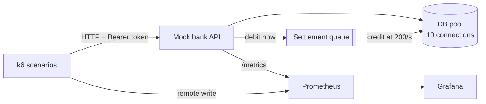

# bank-perf-lab

Performance **and correctness-under-load** testing of a banking API with [k6](https://k6.io).

Most load-testing demos stop at "p95 < 500 ms". In payments, the costly incidents happen when
the system is busy: double debits after a retry, lost updates, overdrafts, a settlement backlog
that never drains. This lab tests both sides: **how fast** the API is, and **whether the money is
still right** when it is under pressure.

> A JMeter version of the main load test is planned (see [Roadmap](#roadmap)).

## What is tested

The system under test is a small **mock banking API** (Node.js, no dependencies) that behaves like
a real one where it matters for performance:



| Endpoint | Purpose |
|---|---|
| `POST /auth/token` | OAuth-like client credentials, token with expiry |
| `GET /accounts/:id` | Balance |
| `GET /accounts/:id/transactions` | Last movements |
| `POST /payments` | Transfer, **`Idempotency-Key` header required** (safe retries) |
| `GET /payments/:id` | Payment status: `PENDING` then `SETTLED` |
| `GET /admin/reconciliation` | Business invariants: money conserved, no overdraft, no duplicate |
| `GET /metrics` | Prometheus metrics: queue depth, DB pool, money drift, memory |

Realistic constraints: a limited **DB connection pool** (latency grows, then `503` when exhausted)
and an **asynchronous settlement queue** (payments are debited at once and credited later, at a
fixed rate, like a clearing system).

**Fault injection** proves the tests are able to fail:

- `--bug=race`: check-then-act race on balances and idempotency keys (lost updates, duplicates)
- `--bug=leak`: idempotency keys never expire and every request is kept in memory

## Test catalogue

| Script | Type | Question | Profile | Pass criteria |
|---|---|---|---|---|
| `smoke.js` | Smoke | Does every endpoint and business rule work? | 1 VU, 5 iterations | 100 % checks, reconciliation OK |
| `load.js` | Load | Do we meet our SLOs at the expected load? | 100 req/s, constant arrival rate | p95 < 300 ms (reads), < 500 ms (payments), < 1 % errors |
| `stress.js` | Stress | Where is the breaking point, how does it fail? | Staircase 50 → 800 req/s | Aborts when p95 > 1.5 s or errors > 5 %: last step = capacity |
| `spike.js` | Spike | Can we absorb payday (*quincena*)? | Browsing x6 + 300 payments/s for 1 min | p95 < 1 s, < 2 % errors, settlement backlog drained in < 2 min |
| `soak.js` | Endurance | Do we degrade over hours? | 80 req/s + a burst of 3,000 payments every hour | Stable latency, queue back to 0 after each burst, memory bounded |
| `concurrency.js` | Correctness under load | Do retries and races corrupt money? | 50 identical requests per key, 100 payments racing on one account | Exactly 1 payment per key, exactly 50/100 accepted, balance 0.00 |

Every test ends with a **reconciliation** (`teardown`): the total amount of money in the bank must
be unchanged, no account may be negative, and no idempotency key may have produced two payments.

The traffic mix (`k6/lib/traffic.js`) mimics a retail banking app: 60 % balance checks,
25 % transaction history, 15 % payments. Every request is tagged with its endpoint name so that
thresholds and dashboards are split per endpoint.

## Results

Measured on a laptop, mock API with default settings (pool of 10 connections, ~20 ms per query,
so about 500 queries/s). Numbers are illustrative; the point is what each test reveals.

| Test | Result |
|---|---|
| Load, 100 req/s | ✅ p95 ≈ 29 ms on every endpoint, 0 errors, reconciliation OK |
| Stress | 🔎 Capacity ≈ **500 req/s**. At 600 req/s latency degrades first (p95 1.5 s, requests queue for a DB connection) before errors appear: the test aborts at that step |
| Spike, pool of 10 | ❌ p95 2 s, 3 % of `503` (pool exhausted). Payday is not absorbed |
| Spike, `POOL_SIZE=20` | ✅ p95 29 ms, 0 errors; settlement backlog peaks at 4,600 payments and drains in 60 s |
| Soak (short version) | ✅ memory flat (55–110 MB), backlog back to 0 after each burst |
| Soak, `--bug=leak` | ❌ memory climbs burst after burst: 53 → 312 MB, threshold crossed |
| Concurrency | ✅ 5 keys → 5 payments; 50 accepted / 50 refused; balance exactly 0.00 |
| Concurrency, `--bug=race` | ❌ 150 payments for 5 keys, 100 overdraft payments accepted, **23,200 PEN created out of nothing** |

## Quick start

Requirements: [Node.js](https://nodejs.org) 18+ and [k6](https://grafana.com/docs/k6/latest/set-up/install-k6/).

```bash
# terminal 1: the API (port 3001)
npm start                    # or: node mock-bank/server.js

# terminal 2: the tests
k6 run k6/smoke.js
k6 run k6/concurrency.js
k6 run -e SHORT=1 k6/load.js     # SHORT=1: demo-length profiles (1 to 6 min)
k6 run -e SHORT=1 k6/stress.js
k6 run -e SHORT=1 k6/spike.js
k6 run -e SHORT=1 k6/soak.js
```

Watch a test fail for the right reason:

```bash
npm run start:race    # then: k6 run k6/concurrency.js
npm run start:leak    # then: k6 run -e SHORT=1 k6/soak.js
```

API settings (environment variables): `PORT`, `POOL_SIZE`, `DB_LATENCY_MS`, `POOL_TIMEOUT_MS`,
`SETTLE_RATE`, `ACCOUNTS`, `TOKEN_TTL_S`. On Windows PowerShell: `$env:POOL_SIZE="20"; npm start`.

k6 settings: `BASE_URL` (default `http://localhost:3001`), `SHORT=1`, `RATE` (load, soak), `HOURS` (soak), `MAX_RATE` (stress, top step, default 800).

## Live dashboards

**Quick look**: `k6 run --out web-dashboard k6/load.js`, then open http://127.0.0.1:5665.

**Prometheus + Grafana** (the setup used in real projects):

1. `prometheus --config.file=monitoring/prometheus.yml --web.enable-remote-write-receiver`
   Prometheus scrapes the API's own `/metrics` and receives k6 metrics by remote write.
2. Run a test with a `testid` tag to compare runs later:
   ```bash
   export K6_PROMETHEUS_RW_SERVER_URL=http://localhost:9090/api/v1/write
   k6 run -o experimental-prometheus-rw --tag testid=spike-pool10 -e SHORT=1 k6/spike.js
   ```
3. In Grafana, add Prometheus as a data source. Useful queries:
   - `bank_settlement_queue_depth`: backlog filling and draining (the "sawtooth")
   - `rate(bank_payments_settled_total[30s])`: settlement throughput
   - `bank_db_pool_waiting`: requests waiting for a connection (saturation)
   - `bank_money_drift_cents`: must stay flat at 0
   - `k6_http_req_duration_p95{testid="spike-pool10"}`: client-side latency

Grafana uses port 3000, the API uses 3001: no conflict.

## Continuous integration

`.github/workflows/k6.yml` runs on every push: smoke, concurrency and a one-minute load test.
k6 exits with a non-zero code when a threshold is crossed, so a performance regression fails the
build. A last step restarts the API with `--bug=race` and **expects** the concurrency test to fail,
which shows that the suite actually detects the defect it was written for.

## Project structure

```
mock-bank/server.js     system under test (no dependencies)
k6/lib/api.js           API client, endpoint tags, reconciliation check
k6/lib/traffic.js       traffic mix and shared thresholds
k6/lib/monitor.js       probe scenario reading /metrics (queue, pool, memory, money drift)
k6/*.js                 one script per test type
monitoring/             Prometheus configuration
.github/workflows/      CI pipeline
```

## Design choices

- **Open model** (`constant-arrival-rate`, `ramping-arrival-rate`): users keep arriving even when
  the server slows down, as in real life. A closed model (fixed number of VUs) hides saturation,
  because slow responses automatically reduce the load.
- **Thresholds per endpoint** with tags, instead of one global p95 that averages fast reads and
  slow payments.
- **Business invariants as thresholds**: reconciliation errors, duplicate payments and overdrafts
  fail the run just like a slow p95.
- **The system exposes its own metrics**: the load tool only generates traffic; the queue depth
  comes from the API, so the same dashboard works with k6 or JMeter.

## Roadmap

- [ ] JMeter version of `load.js` (Thread Groups, CSV Data Set, JSON Extractor, Backend Listener)
- [ ] Grafana dashboard exported as JSON
- [ ] Token renewal for multi-hour soak tests
- [ ] Test data from CSV (`SharedArray`) instead of random accounts

## Background

Inspired by endurance and spike tests I designed for Axway Transfer CFT (file transfer):
a steady background flow plus an hourly burst of 1,000 transfers, monitored with Prometheus and
Grafana, where the key signal was the transfer catalogue draining back to zero after every burst.

---
Lionel Daigremont · QA Engineer · [GitHub](https://github.com/lionel-daigremont)
