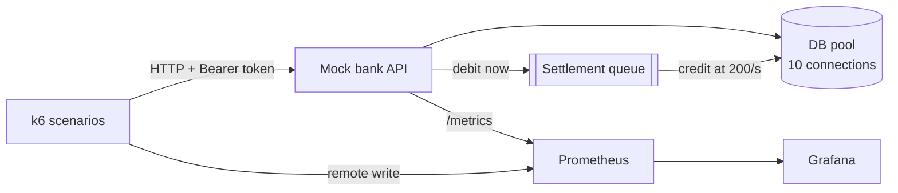
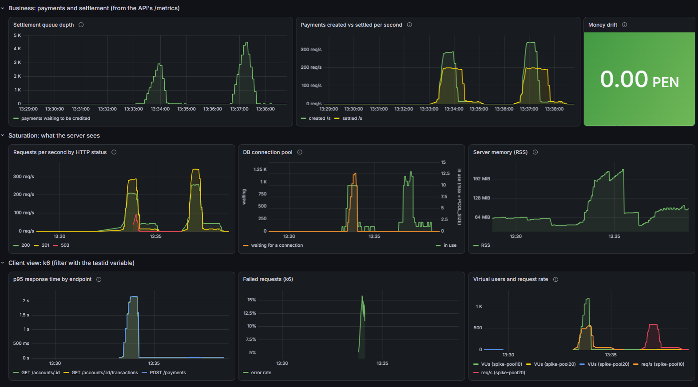

# bank-perf-lab

Performance **and correctness-under-load** testing of a banking API with [k6](https://k6.io).

Most load-testing demos stop at "p95 < 500 ms". In payments, the costly incidents happen when
the system is busy: double debits after a retry, lost updates, overdrafts, a settlement backlog
that never drains. This lab tests both sides: **how fast** the API is, and **whether the money is
still right** when it is under pressure.

> The main load test also exists in JMeter: see [JMeter version](#jmeter-version).

## What is tested

The system under test is a small **mock banking API** (Node.js, no dependencies) that behaves like
a real one where it matters for performance:



| Endpoint | Purpose |
|---|---|
| `POST /auth/token` | OAuth-like client credentials, token with expiry |
| `GET /accounts/:id` | Balance |
| `GET /accounts/:id/transactions` | Last movements |
| `POST /payments` | Transfer, **`Idempotency-Key` header required** (safe retries) |
| `GET /payments/:id` | Payment status: `PENDING` then `SETTLED` |
| `GET /admin/reconciliation` | Business invariants: money conserved, no overdraft, no duplicate |
| `GET /metrics` | Prometheus metrics: queue depth, DB pool, money drift, memory |

Realistic constraints: a limited **DB connection pool** (latency grows, then `503` when exhausted)
and an **asynchronous settlement queue** (payments are debited at once and credited later, at a
fixed rate, like a clearing system).

**Fault injection** proves the tests are able to fail:

- `--bug=race`: check-then-act race on balances and idempotency keys (lost updates, duplicates)
- `--bug=leak`: idempotency keys never expire and every request is kept in memory

## Test catalogue

| Script | Type | Question | Profile | Pass criteria |
|---|---|---|---|---|
| `smoke.js` | Smoke | Does every endpoint and business rule work? | 1 VU, 5 iterations | 100 % checks, reconciliation OK |
| `load.js` | Load | Do we meet our SLOs at the expected load? | 100 req/s, constant arrival rate | p95 < 300 ms (reads), < 500 ms (payments), < 1 % errors |
| `stress.js` | Stress | Where is the breaking point, how does it fail? | Staircase 50 → 800 req/s | Aborts when p95 > 1.5 s or errors > 5 %: last step = capacity |
| `spike.js` | Spike | Can we absorb payday (*quincena*)? | Browsing x6 + 300 payments/s for 1 min | p95 < 1 s, < 2 % errors, settlement backlog drained in < 2 min |
| `soak.js` | Endurance | Do we degrade over hours? | 80 req/s + a burst of 3,000 payments every hour | Stable latency, queue back to 0 after each burst, memory bounded |
| `concurrency.js` | Correctness under load | Do retries and races corrupt money? | 50 identical requests per key, 100 payments racing on one account | Exactly 1 payment per key, exactly 50/100 accepted, balance 0.00 |

Every test ends with a **reconciliation** (`teardown`): the total amount of money in the bank must
be unchanged, no account may be negative, and no idempotency key may have produced two payments.

The traffic mix (`k6/lib/traffic.js`) mimics a retail banking app: 60 % balance checks,
25 % transaction history, 15 % payments. Every request is tagged with its endpoint name so that
thresholds and dashboards are split per endpoint.

## Results

Measured on the author's Windows laptop, mock API with default settings (pool of 10 connections,
~20 ms per query, so about 500 queries/s), `SHORT=1` profiles. Numbers depend on the machine;
the point is what each test reveals.

| Test | Result |
|---|---|
| Load, 100 req/s for 1 min | ✅ p95 ≈ 31 ms on every endpoint, 0 errors out of 6,064 requests, reconciliation OK. Only 2 to 5 VUs needed (Little's law: 100 req/s × 0.023 s ≈ 2.3 concurrent users) |
| Load in **JMeter**, 100 req/s for 1 min (`jmeter/load.jmx`) | ✅ 6,000 requests, **0 errors**, mix respected (60.3 % / 24.6 % / 15.1 %), reconciliation OK. p95 ≈ 36–38 ms per endpoint (k6: ≈ 31 ms), p99 91–183 ms. Same story as k6; the small gap comes from how each tool measures and from JMeter creating one Java thread per arrival |
| Stress | 🔎 Aborted on the **600 req/s** step: p95 reached 1.5 s with **0 errors**. Capacity is between 400 and 600 req/s (~500 in theory). Latency degrades before errors appear, so the latency threshold stops the test before the outage. Saturation also shows on the load generator side: up to ~1,030 VUs and 948 dropped iterations |
| Spike, pool of 10 | ❌ `503` errors (up to ~15 % of requests at the peak), ~1,100 requests waiting for a DB connection, p95 capped at ~2 s (= the pool timeout). Payday is not absorbed |
| Spike, `POOL_SIZE=20` | ✅ no `503`, p95 back to ~30 ms; settlement backlog peaks at ~4,500 payments and drains in about a minute |
| Soak, short version (6 min, 3 bursts of 3,000 payments) | ✅ 0 errors out of 38,193 requests. Each burst fills the settlement queue to ~1,500 and **drains in 16 to 17 s, every time** (no degradation from one burst to the next). Background p95 ≈ 39 ms between bursts (p90), ~175 ms during bursts while requests wait for a DB connection. Memory (RSS) rises from ~46 to ~110–130 MB, then stays at that level. The same happens with idempotency keys expiring after 60 s instead of 10 min: it is the Node.js runtime reserving memory under load and keeping it, not data piling up |
| Soak, `--bug=leak` | ❌ Same queue, latency, error rate and money drift as the normal run: the leak is invisible everywhere **except memory**, which climbs at every burst and never comes down, to ~320 MB (2.5× the reference run). The 256 MB threshold fails the test |
| Concurrency | ✅ 5 keys → 5 payments; 50 accepted / 50 refused; balance exactly 0.00 |
| Concurrency, `--bug=race` | ❌ 150 payments for 5 keys, 100 overdraft payments accepted, **23,200 PEN created out of nothing** |

### Payday spike: 10 vs 20 database connections



Left peak: 10 connections. Right peak: 20 connections. How to read it:

- **DB connection pool**: with 10 connections, ~1,100 requests wait for a connection (orange); with 20, none.
- **Requests by HTTP status**: `503` (red) only during the first spike.
- **p95**: capped at ~2 s during the first spike (requests time out after `POOL_TIMEOUT_MS`), ~30 ms during the second.
- **Settlement queue**: *lower* with 10 connections (~2,900 vs ~4,500), because part of the payments was
  rejected before reaching the queue. A smaller backlog is not always good news: read it together with the error rate.
- **Settlement throughput** stays capped at 200/s in both runs: the bottleneck was the database, not the settlement engine.
- **Money drift** stays at 0.00: under overload the API rejects requests cleanly, it never loses money.
- **Virtual users**: ~1,000 VUs for the same arrival rate with 10 connections. Open-model signature of saturation:
  k6 keeps the planned rate, so slow responses mean more concurrent users.

### Memory: a leak is judged against a reference run

RSS is the memory *reserved* by the process, not the memory in use. In a garbage-collected runtime
(Node.js, the JVM) it grows to a plateau under load and stays there, so a rising RSS alone does not
prove a leak. The soak test therefore compares runs of the same duration: the normal run levels off
around 110–130 MB, the `--bug=leak` run keeps climbing with every burst to ~320 MB. A 6-minute soak
can show a leak; it cannot prove the absence of one, which takes a run long enough to see the plateau.

## Quick start

Requirements: [Node.js](https://nodejs.org) 18+ and [k6](https://grafana.com/docs/k6/latest/set-up/install-k6/).

```bash
# terminal 1: the API (port 3001)
npm start                    # or: node mock-bank/server.js

# terminal 2: the tests
k6 run k6/smoke.js
k6 run k6/concurrency.js
k6 run -e SHORT=1 k6/load.js     # SHORT=1: demo-length profiles (1 to 6 min)
k6 run -e SHORT=1 k6/stress.js
k6 run -e SHORT=1 k6/spike.js
k6 run -e SHORT=1 k6/soak.js
```

Watch a test fail for the right reason:

```bash
npm run start:race    # then: k6 run k6/concurrency.js
npm run start:leak    # then: k6 run -e SHORT=1 k6/soak.js
```

API settings (environment variables): `PORT`, `POOL_SIZE`, `DB_LATENCY_MS`, `POOL_TIMEOUT_MS`,
`SETTLE_RATE`, `ACCOUNTS`, `TOKEN_TTL_S`. On Windows PowerShell: `$env:POOL_SIZE="20"; npm start`.

k6 settings: `BASE_URL` (default `http://localhost:3001`), `SHORT=1`, `RATE` (load, soak), `HOURS` (soak), `MAX_RATE` (stress, top step, default 800).

## Live dashboards

**Quick look**: `k6 run --out web-dashboard k6/load.js`, then open http://127.0.0.1:5665.

**Prometheus + Grafana** (the setup used in real projects):

1. Start Prometheus with the lab configuration. It scrapes the API's own `/metrics` and receives
   k6 metrics by remote write. Native histograms let Grafana compute real percentiles over time:
   ```bash
   prometheus --config.file=monitoring/prometheus.yml --web.enable-remote-write-receiver --enable-feature=native-histograms
   ```
2. Run a test with a `testid` tag, so that runs can be compared later:
   ```bash
   export K6_PROMETHEUS_RW_SERVER_URL=http://localhost:9090/api/v1/write
   export K6_PROMETHEUS_RW_TREND_AS_NATIVE_HISTOGRAM=true
   k6 run -o experimental-prometheus-rw --tag testid=spike-pool10 -e SHORT=1 k6/spike.js
   ```
   PowerShell: `$env:K6_PROMETHEUS_RW_SERVER_URL="http://localhost:9090/api/v1/write"` and
   `$env:K6_PROMETHEUS_RW_TREND_AS_NATIVE_HISTOGRAM="true"`.

   Why native histograms: with the default export (`K6_PROMETHEUS_RW_TREND_STATS`), k6 sends a
   p95 already computed over the whole run, so the curve never goes back down after a spike.
   With histograms, `histogram_quantile(0.95, ...)` gives the p95 of the last few seconds.
3. In Grafana, add Prometheus as a data source (`http://localhost:9090`), then import
   `monitoring/grafana-dashboard.json` (*Dashboards > New > Import*). Three rows:
   - **Business** (from the API): settlement queue depth, payments created vs settled per second,
     money drift (must stay at 0.00)
   - **Saturation** (from the API): requests per second by HTTP status (503 in red), DB pool in use
     and waiting, server memory
   - **Client view** (from k6, filtered by `testid`): p95 per endpoint (sliding window), error rate,
     VUs and request rate

   The first two rows come from the system itself, so they work the same with k6 or JMeter.

Grafana uses port 3000, the API uses 3001: no conflict.

## Continuous integration

`.github/workflows/k6.yml` runs on every push: smoke, concurrency and a one-minute load test.
k6 exits with a non-zero code when a threshold is crossed, so a performance regression fails the
build. A last step restarts the API with `--bug=race` and **expects** the concurrency test to fail,
which shows that the suite actually detects the defect it was written for.

## JMeter version

`jmeter/load.jmx` is the JMeter equivalent of `k6/load.js` (same traffic mix, same rate, same
reconciliation). It uses only core JMeter 5.6 elements, no plugins.

Run from the project root (relative paths in the commands are resolved from the current folder;
the CSV path inside the plan is resolved from the `jmeter/` folder).

```powershell
# GUI: to read, edit and debug the plan (add a View Results Tree listener to see each request)
jmeter -t jmeter/load.jmx

# CLI: for a real run (never load-test from the GUI)
# One report per run, timestamped, so that runs can be compared later (like k6's testid tag)
New-Item -ItemType Directory -Force results | Out-Null   # JMeter does not create the parent folder
$run = Get-Date -Format "yyyyMMdd-HHmm"
jmeter -n -t jmeter/load.jmx "-Jrate=100" "-Jduration=1" -l "results/load-$run.jtl" -e -o "results/load-$run"
```

| Option | Meaning |
|---|---|
| `-n` | non-GUI (CLI) mode |
| `-t` | the test plan |
| `-J<name>=<value>` | sets a property, read in the plan with `${__P(name,default)}` |
| `-l` | raw results file (JTL, one CSV line per request). **Appended to if it already exists**: hence one file per run |
| `-e -o` | generates the HTML report at the end. The folder **must be empty or not exist** |
| `-f` | deletes the JTL and the report folder before starting (use it to overwrite a fixed name instead of timestamping) |
| `-g <jtl> -o <folder>` | regenerates a report from an existing JTL, without running the test again |

Practical notes:

- PowerShell: quote `-J` arguments that contain a dot (`"-Jduration=0.2"`), otherwise PowerShell may split them.
- JMeter takes a few seconds after `... end of run` to build the HTML report (minutes for a long soak).
- The schedule ends with `pause(5 s)`: no new arrivals, so requests still in flight can finish. Without it,
  JMeter cuts the last request when the duration expires and counts it as a `Socket closed` error.
- `results/` is ignored by git.

Properties: `-Jhost` (localhost), `-Jport` (3001), `-Jrate` (requests/s, 100), `-Jduration` (minutes, 1).

| Concept | k6 (`k6/load.js`) | JMeter (`jmeter/load.jmx`) |
|---|---|---|
| Test lifecycle | `setup()` / `default` / `teardown()` | setUp Thread Group / Thread Group / tearDown Thread Group |
| Open model, fixed arrival rate | `constant-arrival-rate` executor | **Open Model Thread Group**: `rate(100/sec) random_arrivals(1 min)` |
| Token correlation | `login()` returns the token to every VU | **JSON Extractor** + JSR223 `props.put()` to share it across thread groups |
| Test data | random account ids | **CSV Data Set Config** (`jmeter/data/accounts.csv`) |
| Traffic mix | `Math.random()` in `bankingUser()` | **Switch Controller** with a `__groovy` weighted choice |
| Idempotency key | `newIdempotencyKey()` | `${__UUID()}` in a Header Manager |
| Checks | `check()` | Response Assertion, JSON Assertion |
| Pass / fail | thresholds, exit code | assertions + error rate in the HTML report (no built-in thresholds) |
| Reconciliation | `checkReconciliation()` | While Controller polling `/admin/reconciliation`, then JSON Assertions |

The server-side Grafana panels (queue, pool, money drift) work unchanged with JMeter, because they
read the API's own `/metrics`.

## Project structure

```
mock-bank/server.js     system under test (no dependencies)
k6/lib/api.js           API client, endpoint tags, reconciliation check
k6/lib/traffic.js       traffic mix and shared thresholds
k6/lib/monitor.js       probe scenario reading /metrics (queue, pool, memory, money drift)
k6/*.js                 one script per test type
monitoring/             Prometheus configuration, Grafana dashboard
jmeter/load.jmx         JMeter version of k6/load.js (generated by jmeter/build_jmx.py)
jmeter/data/            CSV test data for JMeter
.github/workflows/      CI pipeline
```

## Design choices

- **Open model** (`constant-arrival-rate`, `ramping-arrival-rate`): users keep arriving even when
  the server slows down, as in real life. A closed model (fixed number of VUs) hides saturation,
  because slow responses automatically reduce the load.
- **Thresholds per endpoint** with tags, instead of one global p95 that averages fast reads and
  slow payments.
- **Business invariants as thresholds**: reconciliation errors, duplicate payments and overdrafts
  fail the run just like a slow p95.
- **The system exposes its own metrics**: the load tool only generates traffic; the queue depth
  comes from the API, so the same dashboard works with k6 or JMeter.

## Limitations

This is a lab, not a production benchmark. What it does not do, and what a real project would do instead:

- **Everything runs on one machine**: the API, the load generator (k6 or JMeter), Prometheus and Grafana
  share the same CPU and memory, so the generator competes with the system it measures. In a real
  project the injectors run on dedicated machines, and their own CPU and memory are monitored too.
- **The system under test is a mock**: the "database" is an in-memory map behind a simulated connection
  pool with a fixed latency. Real bottlenecks (SQL queries, locks, indexes, network hops between services)
  behave differently; the absolute numbers here are illustrative, the method is what carries over.
- **Short runs**: the `SHORT=1` profiles last 1 to 6 minutes. They can reveal a leak, but proving the
  absence of one takes a soak long enough to see memory level off (hours, not minutes).
- **Single token**: one OAuth token is shared by all virtual users and never renewed. A real test would
  log in per user and handle token expiry.
- **No network latency**: client and server talk over `localhost`, so response times do not include
  the network delays real users would see.
- **Numbers depend on the laptop**: results come from the author's Windows machine; rerun the tests to
  get your own baseline before comparing.

## Roadmap

- [x] JMeter version of `load.js`
- [ ] JMeter results in Grafana (Backend Listener to InfluxDB)
- [x] Grafana dashboard exported as JSON
- [ ] Token renewal for multi-hour soak tests
- [ ] Test data from CSV (`SharedArray`) instead of random accounts

## Background

Inspired by endurance and spike tests I designed for Axway Transfer CFT (file transfer):
a steady background flow plus an hourly burst of 1,000 transfers, monitored with Prometheus and
Grafana, where the key signal was the transfer catalogue draining back to zero after every burst.

---
Lionel Daigremont · QA Engineer · [GitHub](https://github.com/lionel-daigremont)
